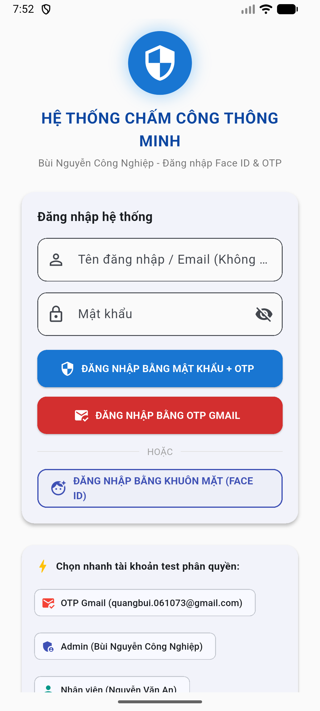
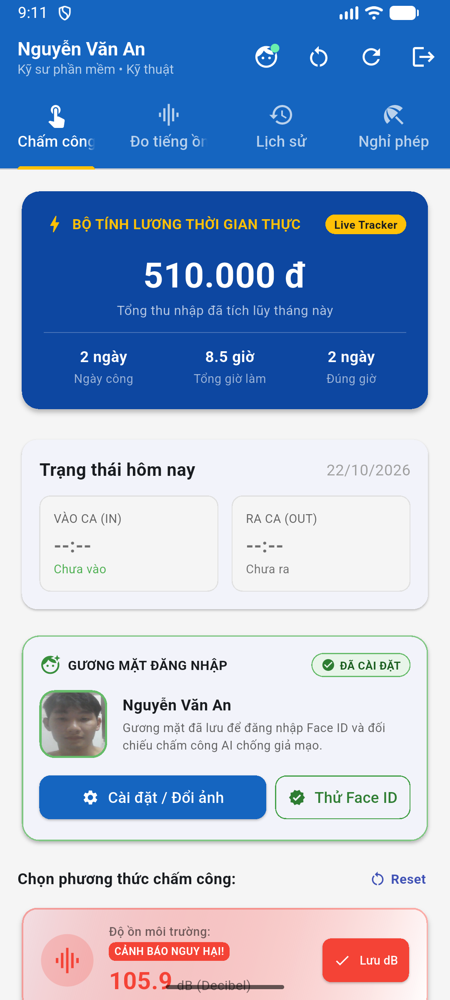
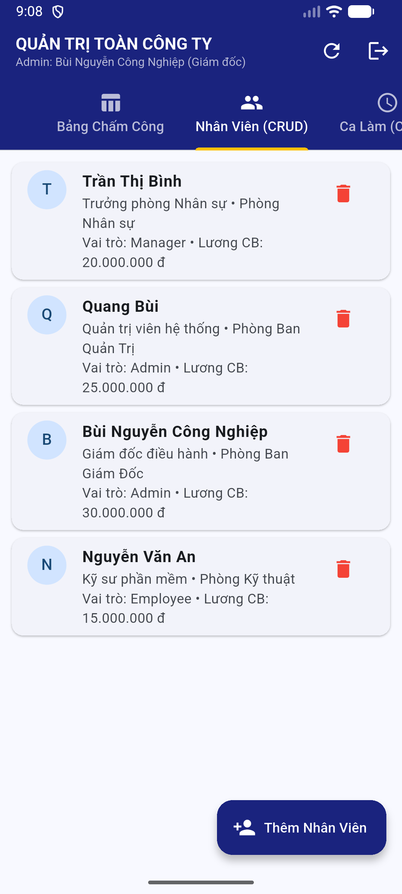
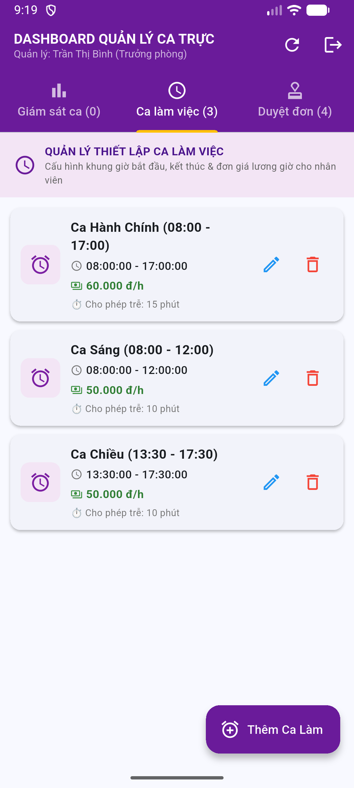
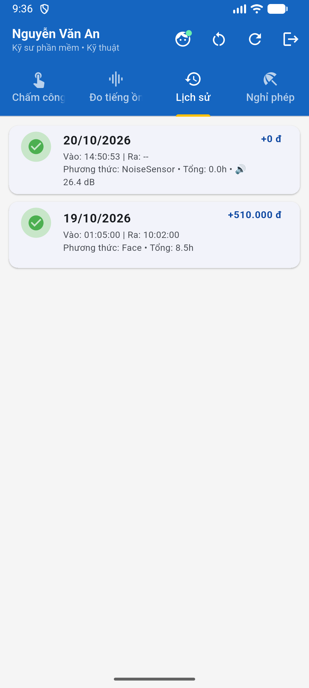

# 📱 HỆ THỐNG CHẤM CÔNG THÔNG MINH - FLUTTER CLIENT (MOBILE & WEB)

<div align="center">


**Ứng dụng di động & Web chấm công đa phương thức thế hệ mới: Nhận diện khuôn mặt 3D Face AI, Định vị vệ tinh GPS Geofencing, Quét mã QR động và Giám sát ô nhiễm tiếng ồn môi trường làm việc thời gian thực.**

🔗 **Backend RESTful Web API Repository:** [https://github.com/congnghip/LTDT_BE](https://github.com/congnghip/LTDT_BE)

</div>

---

## 📸 Hình ảnh giao diện ứng dụng (Application Screenshots)

<div align="center">
  <table>
    <tr>
      <td align="center"><b>🔐 Đăng nhập & Xác thực OTP / Face ID</b></td>
      <td align="center"><b>💼 Dashboard Nhân viên & Bộ tính lương Live</b></td>
    </tr>
    <tr>
      <td></td>
      <td></td>
    </tr>
    <tr>
      <td align="center"><b>👤 Xác thực 3D Face Mesh AI Biometric</b></td>
      <td align="center"><b>🔊 Giám sát ô nhiễm tiếng ồn (78.7 dB)</b></td>
    </tr>
    <tr>
      <td></td>
      <td></td>
    </tr>
    <tr>
      <td align="center"><b>👥 Quản trị Nhân sự Admin (CRUD Employee)</b></td>
      <td align="center"><b>⏰ Quản lý Ca trực & Đơn giá (Manager Shift)</b></td>
    </tr>
    <tr>
      <td></td>
      <td></td>
    </tr>
    <tr>
      <td align="center"><b>📊 Lịch sử chấm công chi tiết</b></td>
      <td align="center"><b>📝 Quản lý & Phê duyệt Đơn nghỉ phép</b></td>
    </tr>
    <tr>
      <td></td>
      <td></td>
    </tr>
  </table>
</div>

---

## 📑 Mục lục
1. [Tính năng chính](#-tính-năng-chính)
2. [Kiến trúc & Công nghệ](#-kiến-trúc--công-nghệ)
3. [Cấu trúc mã nguồn thư mục](#-cấu-trúc-mã-nguồn-thư-mục)
4. [Hướng dẫn cài đặt & Khởi chạy](#-hướng-dẫn-cài-đặt--khởi-chạy)
5. [Cấu hình biến môi trường (.env)](#-cấu-hình-biến-môi-trường-env)
6. [Đóng gói & Triển khai Docker (Web Nginx)](#-đóng-gói--triển-khai-docker-web-nginx)
7. [Tác giả](#-tác-giả)

---

## 🚀 Tính năng chính

### 1. 👤 Chấm công Nhận diện Khuôn mặt (3D Face AI Biometric)
- Tích hợp camera chụp ảnh và phân tích khuôn mặt thời gian thực với **Google ML Kit Face Detection**.
- Hiển thị lưới **Face Mesh Overlay** trực quan gồm các điểm mốc (landmarks: mắt, mũi, miệng, viền mặt).
- Thuật toán so khớp đặc trưng khuôn mặt (Cosine Similarity / Vector Embedding) với ngưỡng tin cậy cao, hỗ trợ chống giả mạo (Anti-spoofing).

### 2. 📍 Định vị địa lý vệ tinh (GPS Geofencing)
- Tự động lấy tọa độ kinh độ và vĩ độ qua GPS của thiết bị (`geolocator`).
- Xác định vị trí nhân viên có nằm trong bán kính cho phép của văn phòng / công xưởng hay không.

### 3. 🔊 Giám sát ô nhiễm tiếng ồn môi trường làm việc
- Thu nhận tín hiệu âm thanh môi trường từ microphone và tính toán mức cường độ âm thanh Decibel (**dB**).
- Trực quan hóa sóng âm với biểu đồ tần số động (Audio Waveform Visualizer).
- Phân loại trực quan:
  - 🟢 **An toàn (< 60 dB):** Văn phòng yên tĩnh, điều kiện làm việc tối ưu.
  - 🟡 **Trung bình (60 - 85 dB):** Tiếng ồn vừa phải, cảnh báo theo dõi.
  - 🔴 **Nguy hiểm (> 85 dB):** Vượt ngưỡng tiêu chuẩn an toàn lao động OSHA, cảnh báo cần đồ bảo hộ tai.

### 4. 💼 Dashboard & Bộ tính lương thời gian thực (Live Salary Tracker)
- Tự động tính toán tổng số giờ làm việc trong ngày và số tiền lương thực nhận dựa trên đơn giá ca.
- Hiển thị trực quan tình trạng ca làm việc: Chưa vào ca, Đang làm việc, Đã tan ca.

### 5. 👥 Phân quyền người dùng đa cấp (Role-Based Access Control)
- **Nhân viên (Employee):**
  - Check-in & Check-out đa phương thức (Face AI, GPS, QR Code).
  - Xem lịch sử chấm công, thời gian vào/ra, mức ồn môi trường ghi nhận.
  - Làm đơn xin nghỉ phép (Nghỉ ốm, việc riêng, nghỉ phép năm) và theo dõi trạng thái phê duyệt.
- **Quản lý (Manager):**
  - Quản lý danh sách ca làm việc (**Shift CRUD**): Xem, tạo mới, chỉnh sửa giờ bắt đầu/kết thúc và đơn giá lương theo giờ.
  - Phê duyệt hoặc từ chối các đơn xin nghỉ phép của nhân viên.
- **Quản trị viên (Admin):**
  - Quản lý toàn diện tài khoản nhân viên (**Employee CRUD**): Thêm nhân viên mới, chỉnh sửa thông tin, phân quyền (`Admin`, `Manager`, `Employee`), đặt lương cơ bản.
  - Phê duyệt đơn xin nghỉ phép trên toàn hệ thống.
  - Thống kê toàn diện lịch sử chấm công công ty.

---

## 🏗 Kiến trúc & Công nghệ

| Thành phần | Công nghệ / Gói thư viện | Mô tả |
|---|---|---|
| **Framework** | **Flutter 3.x (Dart SDK ^3.11.4)** | Nền tảng phát triển đa nền tảng (Android, iOS, Web, Windows) |
| **Giao diện** | **Material 3 Design** | Chuẩn thiết kế hiện đại, hỗ trợ Dynamic Color & Card Design |
| **Networking** | `http: ^1.6.0` | Giao tiếp RESTful API với backend ASP.NET Core |
| **Biến môi trường** | `flutter_dotenv: ^6.0.1` | Quản lý cấu hình `BASE_URL` linh hoạt qua file `.env` |
| **Bảo mật & Lưu trữ** | `shared_preferences: ^2.5.6` & `jwt_decoder: ^2.0.1` | Lưu trữ và giải mã JWT token an toàn trên thiết bị |
| **AI & Camera** | `google_mlkit_face_detection: ^0.14.0`, `image_picker: ^1.2.4`, `image: ^4.12.0` | Nhận diện khuôn mặt và trích xuất đặc trưng hình ảnh |
| **Định vị** | `geolocator: ^14.1.2` | Định vị GPS kinh độ / vĩ độ thời gian thực |
| **Containerization** | **Docker & Nginx** | Đóng gói bản build Flutter Web và phục vụ qua reverse proxy |

---

## 📂 Cấu trúc mã nguồn thư mục

```plaintext
fb_interface/
├── android/                         # Cấu hình Android native (AndroidManifest, Gradle, Permissions)
├── ios/                             # Cấu hình iOS native
├── web/                             # Cấu hình Web (index.html, manifest, icons)
├── screenshots/                     # Ảnh chụp màn hình ứng dụng minh họa
│   ├── screen_launch.png
│   ├── screen_dashboard.png
│   ├── screen_facemesh.png
│   ├── screen_noise_tab.png
│   ├── screen_admin_employees.png
│   ├── screen_shifts.png
│   ├── screen_history.png
│   └── screen_leaves.png
├── lib/
│   ├── main.dart                    # Điểm khởi chạy ứng dụng Flutter (nạp .env, cấu hình theme)
│   ├── config/
│   │   └── config_url.dart          # Bộ phân giải URL backend thông minh (Emulator / Web / Tunnel)
│   ├── models/
│   │   └── app_models.dart          # Định nghĩa cấu trúc dữ liệu Dart (User, Attendance, Shift, LeaveRequest...)
│   ├── screens/
│   │   ├── login_screen.dart        # Màn hình Đăng nhập (Mật khẩu & Face ID)
│   │   ├── registration_screen.dart # Màn hình Đăng ký tài khoản và nhập mã OTP xác thực Email
│   │   ├── employee_dashboard_screen.dart # Giao diện chấm công, Face Mesh, GPS, Đo tiếng ồn và Lịch sử
│   │   ├── manager_dashboard_screen.dart  # Giao diện Quản lý ca trực (CRUD Shift) và duyệt nghỉ phép
│   │   └── admin_dashboard_screen.dart    # Giao diện Quản trị viên (CRUD Nhân sự, Duyệt đơn)
│   ├── services/
│   │   ├── api_client.dart          # Xử lý HTTP requests, tự động gắn Header Bearer JWT Token
│   │   ├── auth_service.dart        # Đăng nhập, đăng ký, xác thực OTP, đổi mật khẩu
│   │   ├── chamcong_service.dart    # Check-in, Check-out, lấy lịch sử, gửi đơn xin nghỉ
│   │   ├── face_detector_service.dart # Nhận diện khuôn mặt ML Kit & trích xuất Landmark
│   │   └── noise_meter_service.dart # Cảm biến đo mức âm thanh Decibel và biểu đồ sóng âm
│   ├── utils/
│   │   ├── auth.dart                # Trợ lý kiểm tra token và trạng thái đăng nhập
│   │   └── sample_faces.dart        # Vector mẫu khuôn mặt thử nghiệm
│   └── widgets/
│       ├── face_mesh_overlay.dart   # Widget vẽ lưới 3D Face Mesh lên khuôn mặt
│       └── noise_meter_widget.dart  # Widget hiển thị đồng hồ đo dB và dải sóng âm
├── .env.example                     # Mẫu file cấu hình biến môi trường BASE_URL
├── Dockerfile                       # Dockerfile phục vụ Flutter Web trên nền Nginx Alpine
├── pubspec.yaml                     # Danh mục thư viện phụ thuộc Flutter
└── README.md                        # Tài liệu hướng dẫn chi tiết
```

---

## 🛠 Hướng dẫn cài đặt & Khởi chạy

### 1. Yêu cầu tiên quyết
- Đã cài đặt [Flutter SDK](https://flutter.dev/docs/get-started/install) (Khuyến nghị 3.29+ / Dart 3.7+).
- Đã cài đặt [Android Studio](https://developer.android.com/studio) và tạo ít nhất 1 máy ảo Android Emulator.
- Backend Web API đang hoạt động (xem hướng dẫn tại [congnghip/LTDT_BE](https://github.com/congnghip/LTDT_BE)).

---

### 2. Cài đặt các thư viện phụ thuộc
Di chuyển vào thư mục dự án và tải các package:
```bash
cd fb_interface
flutter pub get
```

---

### 3. Cấu hình biến môi trường kết nối Backend (`.env`)
Tạo file `.env` từ file mẫu `.env.example`:

**Trên Windows Command Prompt:**
```cmd
copy .env.example .env
```

**Trên Linux / macOS / PowerShell:**
```bash
cp .env.example .env
```

Mở file `.env` và chọn cấu hình phù hợp với môi trường chạy của bạn:
```env
# Lựa chọn 1: Chạy trên Android Emulator (kết nối Backend localhost qua gateway 10.0.2.2)
BASE_URL=http://10.0.2.2:5000/api/

# Lựa chọn 2: Chạy trên Web Browser hoặc Windows App
# BASE_URL=http://localhost:5000/api/

# Lựa chọn 3: Chạy trên điện thoại Android thật (kết nối cùng Wi-Fi)
# BASE_URL=http://192.168.1.xxx:5000/api/

# Lựa chọn 4: Chạy qua Cloudflare Tunnel (Khuyên dùng để test ngoài Internet / 4G)
# BASE_URL=https://your-tunnel-subdomain.trycloudflare.com/api/
```

---

### 4. Khởi chạy ứng dụng

#### Khởi chạy trên Android Emulator:
```bash
# Xem danh sách máy ảo và thiết bị
flutter devices

# Khởi chạy ứng dụng
flutter run
```

#### Khởi chạy trên trình duyệt Web (Chrome):
```bash
flutter run -d chrome
```

#### Khởi chạy trên Windows Desktop:
```bash
flutter run -d windows
```

---

## 🐳 Đóng gói & Triển khai Docker (Web Nginx)

Dự án đã tích hợp sẵn `Dockerfile` nhiều giai đoạn (Multi-stage build) để build Flutter Web và phục vụ bằng máy chủ web nhẹ Nginx:

```bash
# Build Docker image
docker build -t smart-attendance-fe:latest .

# Khởi chạy container trên cổng 8080
docker run -d -p 8080:80 --name attendance_frontend smart-attendance-fe:latest
```

Truy cập ứng dụng tại: `http://localhost:8080`.

---

## 👤 Tác giả

- **Họ và tên:** Bùi Nguyễn Công Nghiệp
- **GitHub:** [@congnghip](https://github.com/congnghip)
- **Email:** buinguyencongnghiep04@gmail.com
- **Đơn vị:** Khoa Công nghệ Thông tin - Trường Đại học Công nghệ TP.HCM (HUTECH)
- **Học phần:** Lập Trình Thiết Bị Di Động (LTDD)

---

## 📄 Giấy phép

Dự án được phân phối theo giấy phép [MIT License](LICENSE).
